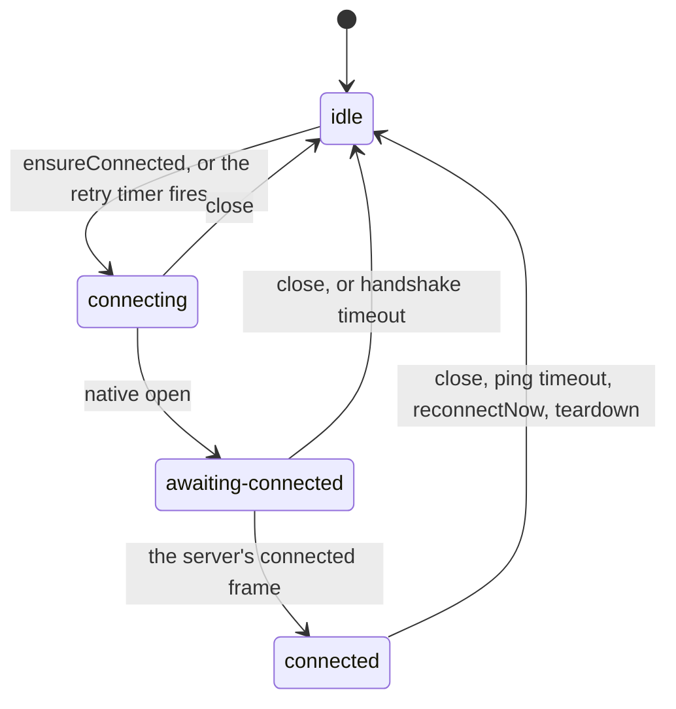
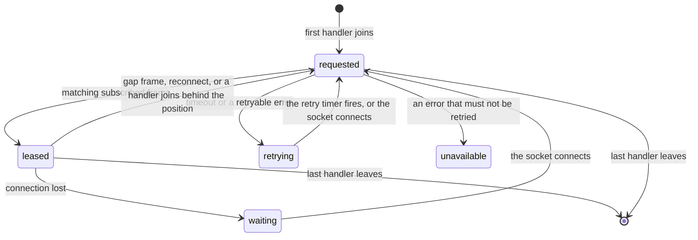
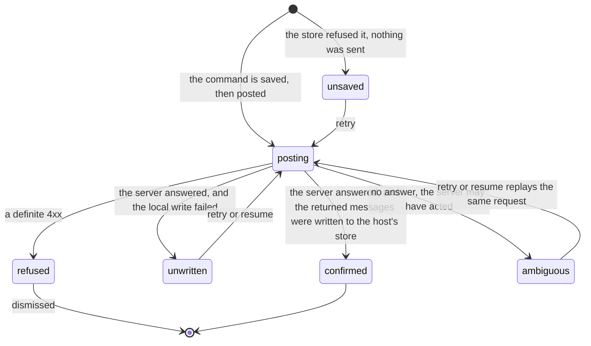

# thread-client state machines

The client for a thread (a chat), shared by the app and the `./mf` command-line tool, which
are its hosts. These are the socket, the per-thread subscription on it, and the commands a
tab sends beside it. What each
owns is in [CONTEXT.md](CONTEXT.md); these are the states.

## Thread socket

One shared WebSocket and its protocol handshake (`SocketLifecycleController` in
`src/socket/socket-lifecycle.ts`). It keeps a private phase and publishes a `ConnectionState`
(`src/socket/thread-transport.ts`) to subscribers.

What subscribers see while the phase is `idle` depends on why the socket closed:

| Published state | When |
|---|---|
| `disconnected` | Nothing wants the connection, or `teardown` |
| `reconnecting` | A retryable close, while the fast retry budget lasts |
| `degraded` | A retryable close after that budget: slow retries, forever |
| `terminal` | A close code that must not be retried. Nothing reconnects after it |

- **Connected means the handshake finished**, not that the socket opened: the retry count
  resets only on the server's `connected` frame. Resetting it on native open makes a server
  that accepts and then drops connections look healthy.
- **Events from an old socket are ignored** (`socketGeneration`). Without that, a late close
  from the previous socket tears down the new one.
- `reset` and `unauthorized` are in the `ConnectionState` union but this controller never
  publishes them. The app's document transport does; see
  [document session](../../../apps/app/src/core/editor/.context/state-machines.md).

The pattern, and its other instances:
[a connection that replays](../../../.context/state-machines/connection-that-replays.md).

## Thread subscription

One thread's subscription on that socket (`ThreadSubscription` in
`src/socket/ws-thread-subscription.ts`). There is no status field: the state is the
combination of `lease`, `request` and `retry.timer`.

| State | `lease` | `request` | Frames |
|---|---|---|---|
| requested | `none` or `active` | set | Live frames are held for handlers that still need the replay |
| leased | `active` | none | Delivered as they arrive |
| retrying | `none` | none, timer set | None |
| waiting | `none` | none | None, until the socket is back |
| unavailable | `none` | none | None; the failure is kept for the UI |

- **One request per thread at a time.** A newer request supersedes the older one; the older
  one's catch-up may still add frames, but it can no longer settle the subscription.
- **Catch-up and held frames are merged by sequence** before anything live reaches a handler
  that was waiting. A handler that receives a live frame ahead of its replay shows the reply
  out of order.
- Leaving stops that handler's callbacks at once, before the unsubscribe frame is sent.

## Hand-back and Stop commands

Messages sent while a reply is running wait in a queue on the server. A hand-back takes
them back, so their words return to the message box; Stop ends the run and does the same.
This machine is one such command (`HandBackOutcome`, `UnresolvedStatus` in
`src/hand-back/operation.ts`). The command is saved to the host's store before it is posted.

- **`ambiguous` keeps the command and replays it exactly.** Treating a lost response as a
  failure drops a command the server may have carried out, and the writer's messages with it.
- **`refused` drops the command but keeps the card** until the writer dismisses it.
- An unresolved entry is retired without an answer once the run state shows the Stop no longer
  matters.

The Stop button reads a separate projection, `stopStatus` in `src/run-state/fold-messages.ts`:
`pending` while the request is in flight, `failed` while a failed Stop still owes the writer
something, `stopping` while the record still shows the execution the answer said it cancelled,
`idle` otherwise. Only the tab that pressed Stop sees `stopping`.

The pattern:
[a command that may have landed](../../../.context/state-machines/command-that-may-have-landed.md).

## Run state

`RunStateView` (`src/run-state/run-state-view.ts`) has no status of its own. It holds the newest
server record and the local intents not yet covered by it: a record replaces the held one only
when its version is newer. The server's answer to an intent names a version, and the intent
is retired when a record arrives at that version or later.
