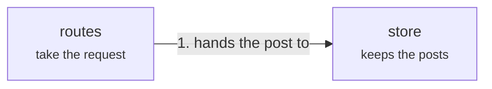

# api

The api service is two modules: a route that takes the post and a store that keeps it.

## routes

One route today, `publish`.

- Kind: module
- Paths: `services/api/src/routes`

## store

An in-memory list standing in for a database.

- Kind: module
- Paths: `services/api/src/store`
