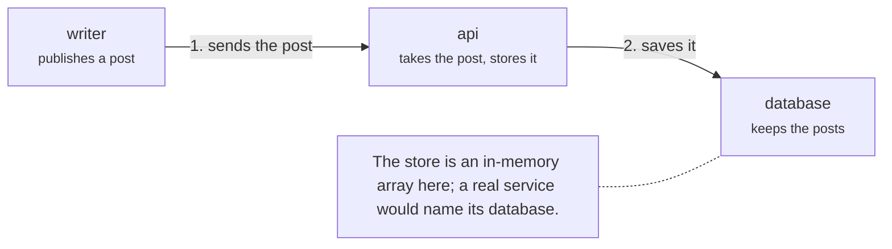

# System

The writer posts from a browser; the `api` service validates nothing and saves the post.

## writer

The person using the service.

- Kind: person

## api

The only service. Its routes take a request and its store keeps what they are given.

- Kind: service
- Paths: `services/api`
- Opens: [api](api.md)

## db

Where the posts live.

- Kind: store
